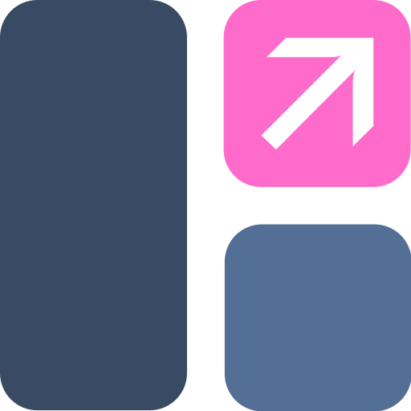

<p align="center">
    
</p>
<p align="center">
    <a href="https://github.com/benhaube/glance-pages/blob/main/LICENSE">
        
    </a>
    
    
</p>
<h1 align="center">
    My Glance Dashboard Configuration
</h1>

This is the collection of YAML files that makes up my [Glance](https://github.com/glanceapp/glance) dashboard configuration. Currently, the service is using a forked Docker image that adds features called [Dynacat](https://github.com/Panonim/dynacat). Dynacat is fully compatible with Glance, but uses a different configuration file, `dynacat.yml`. The old `glance.yml` configuration file remains with the same configuration to maintain compatibility with the Glance Docker image.

See the [Dynacat Documentation](https://dynacat.artur.zone/) for configuration information.

## Directory Structure

```
.
└── glance-pages
    ├── assets
    │   ├── icons
    │   │   ├── *.png
    │   │   └── *.svg
    │   ├── logo.png
    │   ├── logo.svg
    │   └── user.css
    ├── config
    │   ├── pages
    │   │   ├── formula1.yml
    │   │   ├── home.yml
    │   │   └── network.yml
    │   ├── widgets
    │   │   └── *.yml
    │   ├── dynacat.yml
    │   └── glance.yml
    ├── example-compose.yml
    └── README.md
```
